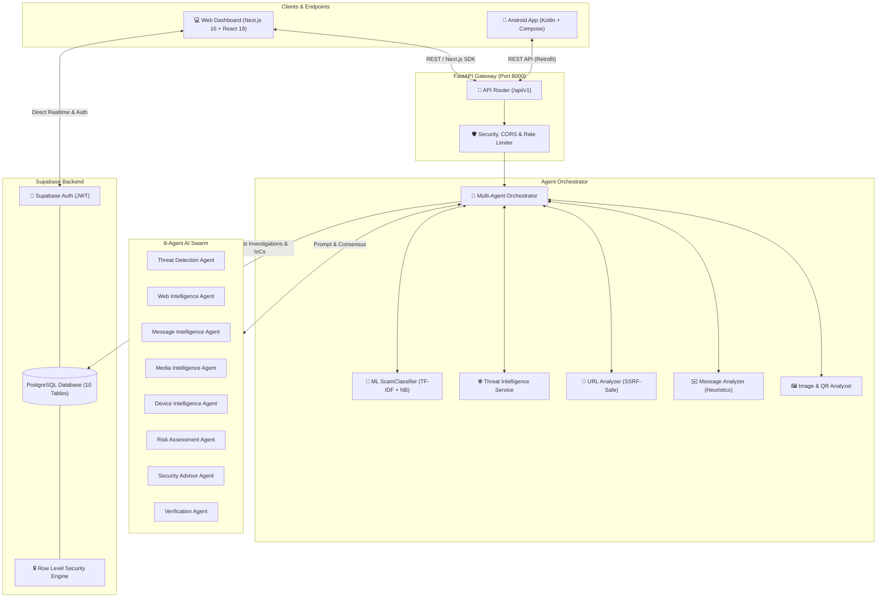

# AEGISOS

```text
    ___    ______ _____ ____ ____   ____  _____
   /   |  / ____// ___//  _// __ \ / __ \/ ___/
  / /| | / __/   \__ \ / / / / / // / / /\__ \ 
 / ___ |/ /___  ___/ // / / /_/ // /_/ /___/ / 
/_/  |_/_____/ /____//___/ \____/ \____//____/  
```

> **Your Digital World. One Intelligent Shield.**

[](https://www.python.org/)
[](https://www.typescriptlang.org/)
[](https://kotlinlang.org/)
[](https://fastapi.tiangolo.com/)
[](https://nextjs.org/)
[](https://supabase.com/)
[](LICENSE)

---

## 🛡️ Overview

**AEGISOS** is an autonomous, AI-driven personal cybersecurity ecosystem designed to protect everyday individuals and enterprise endpoints from modern cyber threats. By unifying threat intelligence, machine learning classifiers, multi-modal heuristic analysis, and a collaborative multi-agent AI swarm, AEGISOS autonomously inspects, scores, and mitigates threats across six critical digital vectors:

* **Web & URLs**: Phishing infrastructure, zero-day credential harvesters, Cyrillic/Greek homograph spoofing, and rogue redirection chains.
* **Messages & SMS**: Banking scams, deceptive UPI payment reversals, urgent KYC cancellation notices, and fake job recruitment lures.
* **Visual Media & QR Codes**: Malicious QR payment payloads, deceptive payment triggers, and embedded visual fraud.
* **Endpoint Applications**: Android APK permission profiling, dangerous permission combinations, and sideloaded app audits.
* **Network & DNS**: Rogue Wi-Fi access points, TLS/SSL interception, and malicious DNS infrastructure.
* **Threat Intelligence**: Real-time cross-referencing with global threat databases, IP reputation networks, and RDAP/WHOIS registry telemetry.

---

## 🌟 Core Modules

* 🌐 **WebGuard**: High-performance URL scanner featuring an SSRF-safe resolution engine, homograph lookalike detection (Cyrillic, Greek, punycode), domain reputation scoring, and SSL certificate validity auditing.
* 💬 **MessageGuard**: Multi-layer social engineering detection engine pairing regex pattern extractors with an onboard TF-IDF + Multinomial Naive Bayes model to identify coercive urgency, fake identity pretexts, and banking fraud.
* 📷 **MediaGuard**: Computer vision and payload extraction pipeline decoding QR barcodes, analyzing embedded URLs or UPI strings, and extracting suspicious phrases via OCR heuristic checks.
* 📱 **AppGuard**: Android mobile defense component auditing installed applications, flagging high-risk permissions (SMS, Accessibility, Camera, Contacts), and computing device posture scores.
* 📶 **NetworkGuard**: Active network watcher inspecting DNS query paths, blocking connections to high-abuse TLDs, and checking for rogue Wi-Fi access points.
* 🧠 **AI Intelligence Engine**: Multi-agent LLM consensus pipeline coordinating 8 specialized agents to cross-examine evidence, eliminate hallucinations, calculate composite risk scores (0–100), and produce human-readable remediation actions.

---

## 🏗️ System Architecture



---

## 💻 Tech Stack

| Component | Technology | Version | Description |
| :--- | :--- | :--- | :--- |
| **Backend API** | FastAPI, Uvicorn | `0.115.0` / `0.30.6` | Asynchronous REST backend with OpenAPI/Swagger docs |
| **Backend Runtime** | Python | `3.11+` | Strict type hints, dataclasses, and async execution |
| **Machine Learning** | Scikit-learn, Joblib | `1.5.2` / `1.4.2` | TF-IDF Vectorizer + Multinomial Naive Bayes model |
| **Media Processing** | Pillow, PyZbar | `10.4.0` / `0.1.9` | Image processing, EXIF inspection, and QR decoding |
| **Database & Auth** | Supabase (PostgreSQL) | `2.7.4` | Relational storage, RLS policies, automated triggers |
| **Frontend Portal** | Next.js, React | `16.4.6` / `19.3.0` | Server & client components, App Router, TypeScript |
| **Styling & Motion** | Tailwind CSS, Framer Motion | `4.3.3` / `14.14.0` | Dark cyber-security UI theme, smooth telemetry animations |
| **Data Viz** | Recharts, Lucide | `3.11.0` / `1.77.0` | Security dials, trend lines, and vector icon sets |
| **Mobile Client** | Kotlin, Jetpack Compose | `1.9.20` / Compose BOM | Native Android app with Material3 and dynamic colors |
| **Networking** | Retrofit, OkHttp, HTTPX | `2.9.0` / `0.27.2` | Secure TLS connections, asynchronous HTTP clients |

---

## 🚀 Getting Started

### Prerequisites

* **Python**: Version `3.11` or higher
* **Node.js**: Version `20.x` or higher and `npm`
* **Android Studio**: Hedgehog (2023.1.1) or newer with JDK 17
* **Supabase**: Active Supabase project (cloud or local CLI instance)

---

### 1. Database Setup (Supabase)

1. Open your Supabase project dashboard and navigate to the **SQL Editor**.
2. Run the initial schema migration:
   * Copy and run the contents of [`supabase/migrations/001_initial_schema.sql`](supabase/migrations/001_initial_schema.sql).
3. Run the Row Level Security (RLS) migration:
   * Copy and run the contents of [`supabase/migrations/002_rls_policies.sql`](supabase/migrations/002_rls_policies.sql).
4. *(Optional Demo Seed)*:
   * Run [`supabase/seed.sql`](supabase/seed.sql) to populate test profiles, devices, historical scans, and pre-configured demo cases.

---

### 2. Environment Configuration

Copy the sample environment file to `.env`:

```bash
cp .env.example .env
```

Edit `.env` to configure your API keys:

```env
# Supabase
SUPABASE_URL=https://your-project.supabase.co
SUPABASE_ANON_KEY=your-anon-key
SUPABASE_SERVICE_KEY=your-service-key

# AI Providers (Google Gemini or Groq)
GEMINI_API_KEY=your-gemini-api-key
GROQ_API_KEY=your-groq-api-key
AI_PROVIDER=gemini

# Backend Security
SECRET_KEY=aegisos-super-secure-jwt-secret-key-production-change-me
BACKEND_URL=http://localhost:8000
CORS_ORIGINS=http://localhost:3000,http://localhost:8000
RATE_LIMIT=60/minute
DEBUG=true

# Frontend Public Environment Variables
NEXT_PUBLIC_SUPABASE_URL=https://your-project.supabase.co
NEXT_PUBLIC_SUPABASE_ANON_KEY=your-anon-key
NEXT_PUBLIC_API_URL=http://localhost:8000
```

---

### 3. Backend Setup

```bash
# Navigate to backend directory
cd backend

# Create and activate Python virtual environment
python -m venv venv

# Windows:
.\venv\Scripts\activate
# Linux/macOS:
source venv/bin/activate

# Install required dependencies
pip install -r requirements.txt

# Start the development server with live reload
uvicorn app.main:app --host 0.0.0.0 --port 8000 --reload
```

The API will be available at `http://localhost:8000`. Interactive documentation is hosted at `http://localhost:8000/docs`.

---

### 4. Frontend Setup

```bash
# Open a new terminal and navigate to frontend directory
cd frontend

# Install dependencies
npm install

# Start Next.js development server
npm run dev
```

The web dashboard will be live at `http://localhost:3000`.

---

### 5. Android Application Setup

1. Open **Android Studio**.
2. Select **Open an Existing Project** and navigate to `d:\Projects\Project-3\android`.
3. Allow Gradle to sync dependencies automatically.
4. Ensure your Android Emulator or physical device is connected with USB Debugging enabled.
5. In `android/app/build.gradle.kts`, verify that `BASE_URL` points to `http://10.0.2.2:8000/` for local Android emulator testing.
6. Click **Run 'app'** (`Shift + F10`) to compile and launch AEGISOS on your device.

---

### 6. Docker Deployment (Optional)

You can launch both the backend and frontend using Docker Compose:

```bash
docker-compose up --build
```

---

## 📡 API Endpoints Summary

| Group | Method | Endpoint | Description | Auth Required |
| :--- | :--- | :--- | :--- | :--- |
| **System** | `GET` | `/health` | System health, version, and AI provider state | No |
| **Scan** | `POST` | `/api/v1/scan/url` | Deep analysis of URLs, domains, and redirects | Optional |
| **Scan** | `POST` | `/api/v1/scan/message` | Fraud, banking, and urgency analysis on text | Optional |
| **Scan** | `POST` | `/api/v1/scan/image` | QR decoding, visual text OCR, and steganography | Optional |
| **Scan** | `POST` | `/api/v1/scan/qr` | Direct payload analysis for UPI and QR links | Optional |
| **Scan** | `GET` | `/api/v1/scan/{scan_id}` | Fetch stored investigation result by scan ID | Optional |
| **Investigations** | `GET` | `/api/v1/investigations` | Paginated investigation history for current user | Yes (Bearer) |
| **Investigations** | `GET` | `/api/v1/investigations/{id}` | Drilldown with full threat indicators (IoCs) | Yes (Bearer) |
| **Investigations** | `DELETE`| `/api/v1/investigations/{id}`| Remove investigation record and IoCs | Yes (Bearer) |
| **Intelligence** | `POST` | `/api/v1/intelligence/domain` | Query domain reputation, DNS, and abuse status | Optional |
| **Intelligence** | `POST` | `/api/v1/intelligence/ip` | Assess IP reputation, Tor exits, and subnets | Optional |
| **Intelligence** | `POST` | `/api/v1/intelligence/url` | Comprehensive URL intelligence scoring | Optional |
| **Devices** | `POST` | `/api/v1/devices/register` | Register or update mobile endpoint telemetry | Yes (Bearer) |
| **Devices** | `GET` | `/api/v1/devices` | List registered devices belonging to user | Yes (Bearer) |
| **Devices** | `GET` | `/api/v1/devices/{id}/security`| Retrieve real-time security posture score | Yes (Bearer) |
| **Analytics** | `GET` | `/api/v1/analytics/overview` | High-level risk score, scans, and blocks | Yes (Bearer) |
| **Analytics** | `GET` | `/api/v1/analytics/threats` | Distribution of threat vectors and categories | Yes (Bearer) |
| **Analytics** | `GET` | `/api/v1/analytics/history` | Chronological activity timeline | Yes (Bearer) |
| **Settings** | `GET` | `/api/v1/settings` | Retrieve user configuration and alerts | Yes (Bearer) |
| **Settings** | `PUT` | `/api/v1/settings` | Update alert delivery and analysis depth | Yes (Bearer) |
| **Demo** | `GET` | `/api/v1/demo/scenarios` | List 5 built-in live attack scenarios | No |
| **Demo** | `POST` | `/api/v1/demo/run/{id}` | Execute live analysis battery on demo scenario | No |

*Detailed request and response schemas can be found in [`docs/api.md`](docs/api.md).*

---

## 📁 Project Directory Tree

```text
d:\Projects\Project-3
├── .env.example                  # Environment template with all required keys
├── .gitignore                    # Git ignore file for Python, Node, Android
├── docker-compose.yml            # Multi-container orchestration (FastAPI + Next.js)
├── CONTRIBUTING.md               # Contribution and coding standards
├── DEVELOPMENT_STATUS.md         # Detailed milestone & feature tracking
├── LICENSE                       # MIT License
├── README.md                     # Project overview and documentation
│
├── android/                      # Native Kotlin Android Application
│   ├── build.gradle.kts          # Top-level Gradle build configuration
│   ├── gradle.properties         # JVM arguments and AndroidX flags
│   ├── settings.gradle.kts       # Repository definitions and subprojects
│   └── app/
│       ├── build.gradle.kts      # App module dependencies (Compose, Retrofit)
│       └── src/main/java/com/aegisos/app/
│           ├── data/api/         # Retrofit API interface & models
│           ├── data/local/       # DataStore and local SQLite caching
│           ├── data/repository/  # Security scan & device repositories
│           ├── navigation/       # Jetpack Compose screen navigation
│           ├── services/         # Background SMS & notification listener
│           ├── ui/components/    # Reusable Compose security widgets
│           ├── ui/screens/       # Scanner, Dashboard, and History screens
│           ├── ui/theme/         # Dark cybersecurity Compose themes
│           └── utils/            # Hash helpers, network state checkers
│
├── backend/                      # FastAPI Python Backend
│   ├── requirements.txt          # Python dependencies
│   ├── app/
│   │   ├── main.py               # Application factory, lifespan, CORS, middleware
│   │   ├── agents/
│   │   │   ├── ai_provider.py    # Gemini & Groq multi-provider abstraction
│   │   │   └── orchestrator.py   # Multi-agent investigation coordinator
│   │   ├── api/v1/               # Endpoint routers
│   │   │   ├── analytics.py      # KPI metrics and threat statistics
│   │   │   ├── demo.py           # Demo scenarios for hackathon presentations
│   │   │   ├── devices.py        # Endpoint enrollment and posture checks
│   │   │   ├── intelligence.py   # Domain, IP, and URL threat intel
│   │   │   ├── investigations.py # Case management and IoC review
│   │   │   ├── router.py         # Sub-router registry
│   │   │   ├── scan.py           # Core multi-vector scanning endpoints
│   │   │   └── settings.py       # User preferences and notification rules
│   │   ├── core/
│   │   │   ├── config.py         # Pydantic BaseSettings environment loader
│   │   │   ├── database.py       # Supabase client singleton
│   │   │   ├── logging.py        # Structured JSON structlog middleware
│   │   │   └── security.py       # JWT decoder, HTTP Bearer auth, SlowAPI limiter
│   │   ├── ml/
│   │   │   └── classifier.py     # TF-IDF + Naive Bayes scam detection pipeline
│   │   ├── models/
│   │   │   └── database.py       # SQLAlchemy / Supabase data mappings
│   │   ├── schemas/
│   │   │   ├── requests.py       # Pydantic input validation models
│   │   │   └── responses.py      # Standardized API response structures
│   │   └── services/
│   │       ├── image_analyzer.py # QR decoding, OCR extraction, visual risk
│   │       ├── message_analyzer.py # Regex heuristics for UPI/KYC/Bank scams
│   │       ├── threat_intel.py   # Offline DNS/RDAP checks & threat feeds
│   │       └── url_analyzer.py   # Homograph checks, SSRF guards, TLD risk
│   └── tests/
│       ├── test_api.py           # Endpoint integration tests
│       ├── test_message_analyzer.py # Message heuristics unit tests
│       └── test_url_analyzer.py  # URL analyzer & SSRF unit tests
│
├── docs/                         # Detailed Architecture & Technical Docs
│   ├── api.md                    # Complete API documentation & JSON examples
│   ├── architecture.md           # System architecture, data flow & 8-agent swarm
│   ├── database.md               # 10-table ER diagram, schema, and RLS policies
│   └── security.md               # Threat modeling, SSRF, auth & file safety
│
├── frontend/                     # Next.js 16 Web Application
│   ├── package.json              # React 19, Tailwind, Framer Motion, Recharts
│   ├── tsconfig.json             # TypeScript compiler settings
│   └── src/
│       ├── app/                  # Next.js App Router (layout, page)
│       ├── components/dashboard/ # Risk gauges, trust dials, scan animations
│       └── lib/
│           └── mockData.ts       # 30-day telemetry, events, and mock cases
│
└── supabase/                     # Database Migrations & Seeds
    ├── seed.sql                  # Comprehensive demo seed data
    └── migrations/
        ├── 001_initial_schema.sql # 10 tables, triggers, indexes, and constraints
        └── 002_rls_policies.sql   # Strict Row Level Security policies
```

---

## 🤝 Contributing

We welcome contributions to AEGISOS! Please review our [`CONTRIBUTING.md`](CONTRIBUTING.md) guide for details on:

* Local code formatting (`ruff`, `black`, `prettier`, `ktlint`)
* Git branch conventions (`feat/`, `fix/`, `docs/`)
* Creating pull requests and running automated verification suites

---

## 📜 License

This project is licensed under the **MIT License** — see the [`LICENSE`](LICENSE) file for complete details.

Copyright © 2024 **AEGISOS Team**.
