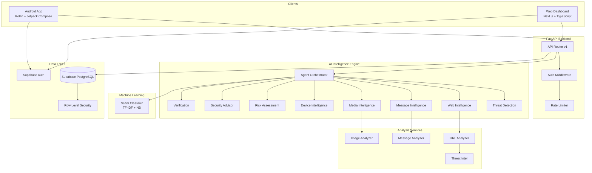

# AEGISOS Architecture

## System Overview

AEGISOS is a multi-component cybersecurity ecosystem comprising an Android mobile application, a Next.js web dashboard, a FastAPI backend, an AI-powered threat intelligence engine, ML classification services, and a Supabase PostgreSQL database.

## Component Diagram

## Multi-Agent AI Engine

8 specialized agents with distinct responsibilities:

| Agent | Role | Input | Output |
|-------|------|-------|--------|
| Threat Detection | Classify input type | Raw input | Pipeline selection |
| Web Intelligence | Investigate domains/URLs | URL, domain | Reputation, SSL, phishing indicators |
| Message Intelligence | Analyze scam patterns | Message text | Scam category, suspicious phrases |
| Media Intelligence | Process images/QR | Image, OCR text | Extracted threats |
| Device Intelligence | Evaluate device security | Permissions | Risk assessment |
| Risk Assessment | Combine evidence | All findings | Risk score 0-100 |
| Security Advisor | Generate recommendations | Assessment | Prioritized actions |
| Verification | Validate findings | All findings | Verified vs. uncertain |

Each agent produces structured JSON. Fallback to rule-based analysis when AI APIs are unavailable.

## Investigation Flow

1. User submits input via Android or web
2. FastAPI validates and authenticates the request
3. Agent Orchestrator creates investigation and routes to pipeline
4. Specialized agents analyze in sequence
5. ML classifier scores scam probability
6. Risk Assessment combines all evidence
7. Results stored in Supabase
8. Client receives structured investigation report
