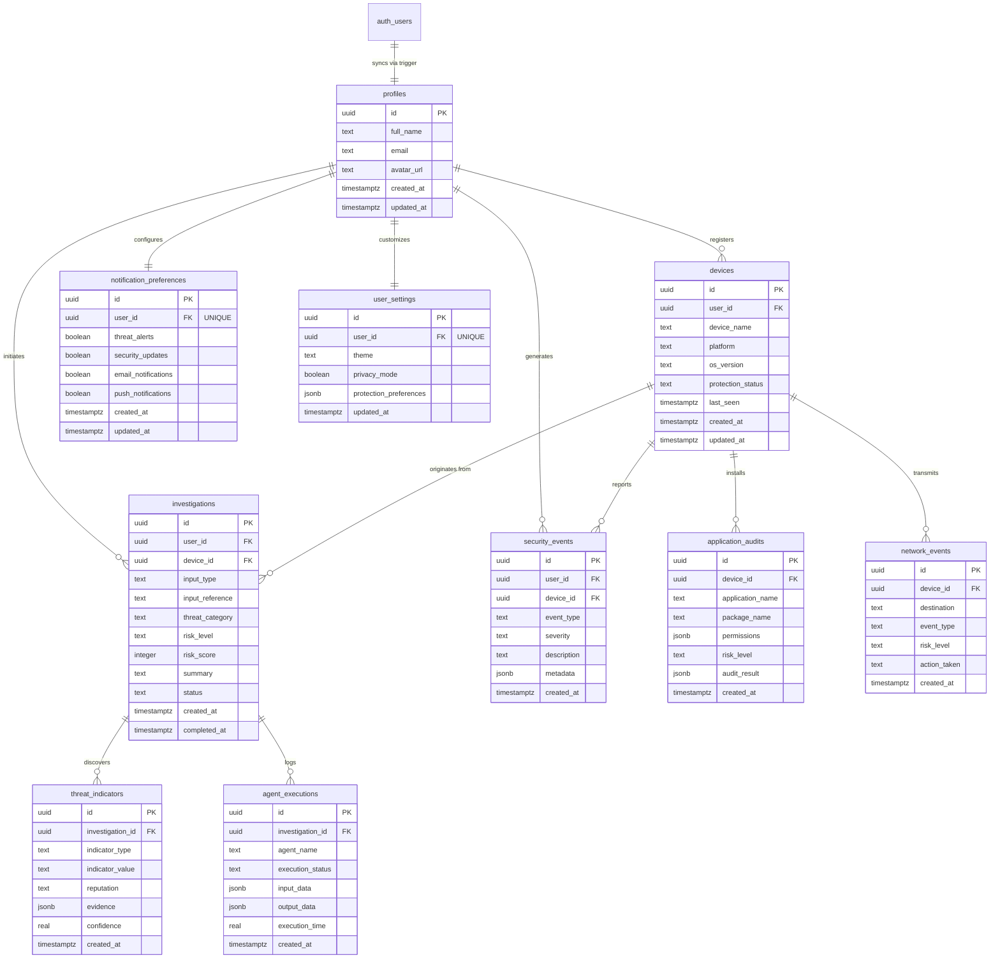

# AEGISOS Database Architecture & Schema Documentation

> **Database Engine:** PostgreSQL 15+ (Hosted on Supabase)  
> **Extensions Enabled:** `uuid-ossp`, `pgcrypto`  
> **Security Model:** Strict Row Level Security (RLS) across all tables with Service Role bypass  
> **Schema Migrations:** Managed under `supabase/migrations/`

---

## 1. Entity-Relationship (ER) Diagram

The diagram below illustrates all 10 platform tables, foreign key constraints, and relational cardinalities:



---

## 2. Table Specifications & Columns

### 2.1 `profiles`
Synchronized with `auth.users` upon signup via database triggers. Stores user identity and operational profile metadata.

| Column | Type | Constraints | Description |
| :--- | :--- | :--- | :--- |
| `id` | `UUID` | `PRIMARY KEY`, `REFERENCES auth.users(id) ON DELETE CASCADE` | Matches the Supabase Auth user ID. |
| `full_name` | `TEXT` | Nullable | User display name or analyst callsign. |
| `email` | `TEXT` | Nullable | User contact and notification address. |
| `avatar_url`| `TEXT` | Nullable | HTTPS profile picture reference. |
| `created_at`| `TIMESTAMPTZ` | `NOT NULL`, `DEFAULT now()` | Account creation timestamp. |
| `updated_at`| `TIMESTAMPTZ` | `NOT NULL`, `DEFAULT now()` | Last update timestamp (auto-updated by trigger). |

---

### 2.2 `devices`
Enrolled mobile and desktop endpoints protected by the AEGISOS client application.

| Column | Type | Constraints | Description |
| :--- | :--- | :--- | :--- |
| `id` | `UUID` | `PRIMARY KEY`, `DEFAULT gen_random_uuid()` | Unique device hardware identifier. |
| `user_id` | `UUID` | `NOT NULL`, `REFERENCES profiles(id) ON DELETE CASCADE` | Enrolling user account. |
| `device_name` | `TEXT` | `NOT NULL` | Human-readable alias (e.g., "Pixel 8 Pro"). |
| `platform` | `TEXT` | `NOT NULL` | Operating system: `android`, `windows`, `macos`, `linux`, `ios`. |
| `os_version` | `TEXT` | Nullable | OS release version and API level. |
| `protection_status` | `TEXT` | `NOT NULL`, `DEFAULT 'active'`, `CHECK IN ('active', 'degraded', 'vulnerable', 'offline', 'disabled')` | Real-time defense state. |
| `last_seen` | `TIMESTAMPTZ` | `DEFAULT now()` | Most recent heartbeat timestamp. |
| `created_at` | `TIMESTAMPTZ` | `NOT NULL`, `DEFAULT now()` | Registration timestamp. |
| `updated_at` | `TIMESTAMPTZ` | `NOT NULL`, `DEFAULT now()` | Posture update timestamp. |

---

### 2.3 `investigations`
Central threat investigation records representing individual URL, message, image, or QR scans.

| Column | Type | Constraints | Description |
| :--- | :--- | :--- | :--- |
| `id` | `UUID` | `PRIMARY KEY`, `DEFAULT gen_random_uuid()` | Unique investigation case ID. |
| `user_id` | `UUID` | `NOT NULL`, `REFERENCES profiles(id) ON DELETE CASCADE` | Initiating user or owner. |
| `device_id` | `UUID` | `REFERENCES devices(id) ON DELETE SET NULL` | Sensor endpoint that submitted the artifact. |
| `input_type` | `TEXT` | `NOT NULL` | Target type: `url`, `message`, `image`, `qr`, `apk`, `network`. |
| `input_reference` | `TEXT` | Nullable | Cleaned URL string, sender ID, or hash identifier. |
| `threat_category` | `TEXT` | Nullable | Identified category: `phishing`, `malware`, `upi_fraud`, `kyc_scam`, etc. |
| `risk_level` | `TEXT` | `CHECK IN ('safe', 'low', 'medium', 'high', 'critical')` | Qualitative risk classification. |
| `risk_score` | `INTEGER`| `CHECK (risk_score >= 0 AND risk_score <= 100)` | Composite risk score (0 to 100). |
| `summary` | `TEXT` | Nullable | Human-readable executive evaluation. |
| `status` | `TEXT` | `NOT NULL`, `DEFAULT 'pending'`, `CHECK IN ('pending', 'analyzing', 'completed', 'failed')` | Pipeline state. |
| `created_at` | `TIMESTAMPTZ` | `NOT NULL`, `DEFAULT now()` | Case creation time. |
| `completed_at` | `TIMESTAMPTZ` | Nullable | Pipeline conclusion time. |

---

### 2.4 `threat_indicators`
Extracted Indicators of Compromise (IoCs) discovered during security investigations.

| Column | Type | Constraints | Description |
| :--- | :--- | :--- | :--- |
| `id` | `UUID` | `PRIMARY KEY`, `DEFAULT gen_random_uuid()` | Unique IoC identifier. |
| `investigation_id` | `UUID` | `NOT NULL`, `REFERENCES investigations(id) ON DELETE CASCADE` | Parent investigation case. |
| `indicator_type` | `TEXT` | `NOT NULL` | `url`, `domain`, `ip`, `sha256`, `cve`, `phone`, `upi`. |
| `indicator_value` | `TEXT` | `NOT NULL` | Target indicator string (e.g. `bad-host.xyz`). |
| `reputation` | `TEXT` | Nullable | `malicious`, `suspicious`, `clean`, `unknown`. |
| `evidence` | `JSONB` | `NOT NULL`, `DEFAULT '{}'` | Detailed evidence payloads and matched rules. |
| `confidence` | `REAL` | `CHECK (confidence >= 0.0 AND confidence <= 1.0)` | Detection confidence level. |
| `created_at` | `TIMESTAMPTZ` | `NOT NULL`, `DEFAULT now()` | Discovery timestamp. |

---

### 2.5 `security_events`
Real-time security telemetry, threat alerts, and automated defensive mitigation events.

| Column | Type | Constraints | Description |
| :--- | :--- | :--- | :--- |
| `id` | `UUID` | `PRIMARY KEY`, `DEFAULT gen_random_uuid()` | Unique event ID. |
| `user_id` | `UUID` | `NOT NULL`, `REFERENCES profiles(id) ON DELETE CASCADE` | Associated user profile. |
| `device_id` | `UUID` | `REFERENCES devices(id) ON DELETE SET NULL` | Reporting endpoint. |
| `event_type` | `TEXT` | `NOT NULL` | `threat_blocked`, `phishing_alert`, `anomaly_detected`. |
| `severity` | `TEXT` | `NOT NULL`, `CHECK IN ('info', 'low', 'medium', 'high', 'critical')` | Event priority. |
| `description` | `TEXT` | `NOT NULL` | Event summary and action taken. |
| `metadata` | `JSONB` | `NOT NULL`, `DEFAULT '{}'` | Diagnostic telemetry and contextual logs. |
| `created_at` | `TIMESTAMPTZ` | `NOT NULL`, `DEFAULT now()` | Event emission timestamp. |

---

### 2.6 `agent_executions`
Execution traces and reasoning logs for individual AI agents in the 8-agent swarm.

| Column | Type | Constraints | Description |
| :--- | :--- | :--- | :--- |
| `id` | `UUID` | `PRIMARY KEY`, `DEFAULT gen_random_uuid()` | Unique execution log record. |
| `investigation_id` | `UUID` | `NOT NULL`, `REFERENCES investigations(id) ON DELETE CASCADE` | Target case. |
| `agent_name` | `TEXT` | `NOT NULL` | Name of the executing AI agent (e.g., `WebIntelligenceAgent`). |
| `execution_status` | `TEXT` | `NOT NULL`, `DEFAULT 'pending'`, `CHECK IN ('pending', 'running', 'completed', 'failed', 'skipped')` | Execution state. |
| `input_data` | `JSONB` | `NOT NULL`, `DEFAULT '{}'` | Agent input parameters and context. |
| `output_data` | `JSONB` | `NOT NULL`, `DEFAULT '{}'` | Structured JSON findings from LLM. |
| `execution_time` | `REAL` | Nullable | Agent runtime duration in seconds. |
| `created_at` | `TIMESTAMPTZ` | `NOT NULL`, `DEFAULT now()` | Invocation timestamp. |

---

### 2.7 `application_audits`
Security evaluation records for packages and applications installed on monitored mobile endpoints.

| Column | Type | Constraints | Description |
| :--- | :--- | :--- | :--- |
| `id` | `UUID` | `PRIMARY KEY`, `DEFAULT gen_random_uuid()` | Audit record ID. |
| `device_id` | `UUID` | `NOT NULL`, `REFERENCES devices(id) ON DELETE CASCADE` | Target mobile device. |
| `application_name`| `TEXT` | `NOT NULL` | Label (e.g., "Flashlight Pro"). |
| `package_name` | `TEXT` | `NOT NULL` | Android package (e.g., `com.fraud.torch`). |
| `permissions` | `JSONB` | `NOT NULL`, `DEFAULT '[]'` | Array of requested Android permissions. |
| `risk_level` | `TEXT` | `CHECK IN ('safe', 'low', 'medium', 'high', 'critical')` | Evaluated application risk. |
| `audit_result` | `JSONB` | `NOT NULL`, `DEFAULT '{}'` | Audit findings, dangerous combinations, and notes. |
| `created_at` | `TIMESTAMPTZ` | `NOT NULL`, `DEFAULT now()` | Audit execution timestamp. |

---

### 2.8 `network_events`
Packet telemetry, outbound connections, DNS requests, and firewall mitigation records.

| Column | Type | Constraints | Description |
| :--- | :--- | :--- | :--- |
| `id` | `UUID` | `PRIMARY KEY`, `DEFAULT gen_random_uuid()` | Network log entry. |
| `device_id` | `UUID` | `NOT NULL`, `REFERENCES devices(id) ON DELETE CASCADE` | Source device. |
| `destination` | `TEXT` | `NOT NULL` | Target IP address or domain name. |
| `event_type` | `TEXT` | `NOT NULL` | `dns_query`, `tcp_connect`, `blocked_connection`. |
| `risk_level` | `TEXT` | `CHECK IN ('safe', 'low', 'medium', 'high', 'critical')` | Connection hazard rating. |
| `action_taken` | `TEXT` | `NOT NULL` | `allowed`, `blocked`, `flagged`, `quarantined`. |
| `created_at` | `TIMESTAMPTZ` | `NOT NULL`, `DEFAULT now()` | Event log timestamp. |

---

### 2.9 `notification_preferences`
User-configured channels and delivery rules for security alerts and urgent notifications.

| Column | Type | Constraints | Description |
| :--- | :--- | :--- | :--- |
| `id` | `UUID` | `PRIMARY KEY`, `DEFAULT gen_random_uuid()` | Preference record ID. |
| `user_id` | `UUID` | `NOT NULL`, `UNIQUE`, `REFERENCES profiles(id) ON DELETE CASCADE` | Owning user. |
| `threat_alerts` | `BOOLEAN` | `NOT NULL`, `DEFAULT true` | Deliver alerts on detected attacks. |
| `security_updates`| `BOOLEAN`| `NOT NULL`, `DEFAULT true` | Receive engine & vulnerability bulletins. |
| `email_notifications` | `BOOLEAN` | `NOT NULL`, `DEFAULT false` | Enable email digest/alerts. |
| `push_notifications` | `BOOLEAN` | `NOT NULL`, `DEFAULT true` | Enable mobile push notifications. |
| `created_at` | `TIMESTAMPTZ` | `NOT NULL`, `DEFAULT now()` | Record creation timestamp. |
| `updated_at` | `TIMESTAMPTZ` | `NOT NULL`, `DEFAULT now()` | Last update timestamp. |

---

### 2.10 `user_settings`
Workbench parameters, visual themes, telemetry consent, and autonomous isolation rules.

| Column | Type | Constraints | Description |
| :--- | :--- | :--- | :--- |
| `id` | `UUID` | `PRIMARY KEY`, `DEFAULT gen_random_uuid()` | Configuration record ID. |
| `user_id` | `UUID` | `NOT NULL`, `UNIQUE`, `REFERENCES profiles(id) ON DELETE CASCADE` | Owning user profile. |
| `theme` | `TEXT` | `NOT NULL`, `DEFAULT 'dark'` | UI theme (`dark`, `light`, `system`). |
| `privacy_mode` | `BOOLEAN` | `NOT NULL`, `DEFAULT false` | Restrict anonymized telemetry collection. |
| `protection_preferences` | `JSONB` | `NOT NULL`, `DEFAULT '{}'` | Fine-grained module toggles. |
| `updated_at` | `TIMESTAMPTZ` | `NOT NULL`, `DEFAULT now()` | Settings update timestamp. |

---

## 3. Row Level Security (RLS) Policy Summary

RLS is enabled across **all 10 tables** via `ALTER TABLE ... ENABLE ROW LEVEL SECURITY;`. Every operation follows strict tenant isolation:

```text
Authenticated Request (auth.uid())
      │
      ├── Directly owned tables:
      │     profiles, devices, investigations, security_events,
      │     notification_preferences, user_settings
      │     └── Filter: user_id = auth.uid()
      │
      ├── Investigation-derived tables:
      │     threat_indicators, agent_executions
      │     └── Filter: EXISTS (SELECT 1 FROM investigations i
      │                         WHERE i.id = table.investigation_id
      │                           AND i.user_id = auth.uid())
      │
      └── Device-derived tables:
            application_audits, network_events
            └── Filter: EXISTS (SELECT 1 FROM devices d
                                WHERE d.id = table.device_id
                                  AND d.user_id = auth.uid())
```

### Policy Breakdown:
1. **Service Role Bypass (`service_role`)**: Backend background tasks, async persistence workers, and administrative scripts run using the Supabase `service_role` key and bypass user restrictions via `CREATE POLICY "Service role bypass on [table]" ON [table] FOR ALL TO service_role USING (true) WITH CHECK (true);`.
2. **Profiles**: Users can only `SELECT`, `INSERT`, `UPDATE`, and `DELETE` their own profile where `auth.uid() = id`.
3. **Devices & Investigations**: Only rows where `auth.uid() = user_id` are returned or modifiable.
4. **Relational Cascade Isolation**: `threat_indicators` and `agent_executions` require verification that the parent investigation belongs to `auth.uid()`. Similarly, `application_audits` and `network_events` verify ownership of the associated `device_id`.

---

## 4. Migration & Seeding Instructions

### Method A: Supabase Web Dashboard (Recommended for Hackathons)
1. Navigate to your project in the [Supabase Dashboard](https://supabase.com/dashboard).
2. Click on the **SQL Editor** tab in the left sidebar.
3. Open [`supabase/migrations/001_initial_schema.sql`](../supabase/migrations/001_initial_schema.sql), paste the entire script into the editor, and click **Run**.
4. Open [`supabase/migrations/002_rls_policies.sql`](../supabase/migrations/002_rls_policies.sql), paste into the editor, and click **Run**.
5. *(Optional)* Open [`supabase/seed.sql`](../supabase/seed.sql), paste, and run to seed test accounts, sample investigations, indicators, and historical telemetry.

### Method B: Supabase CLI (Local Development)
```bash
# Install and link Supabase CLI
npm install -g supabase
supabase login
supabase link --project-ref <your-project-id>

# Apply migrations
supabase db push

# Apply seed data
supabase db reset
```
