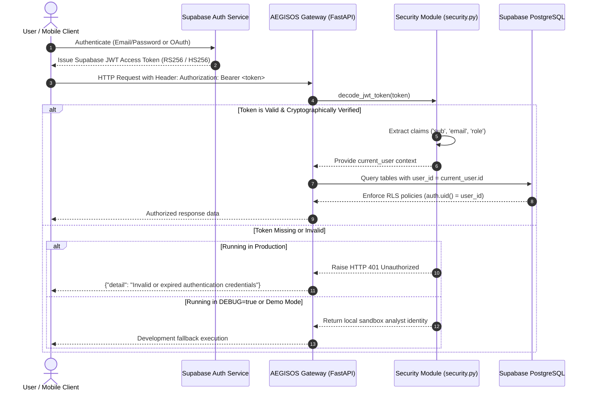
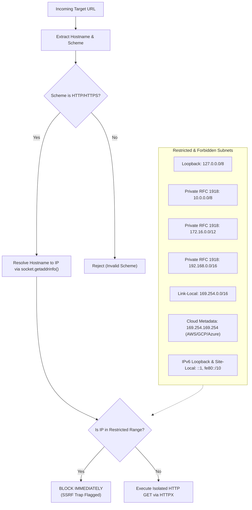

# AEGISOS Security Architecture & Hardening Guide

> **Security Classification:** Defense-in-Depth Cyber Defense Engine  
> **Target Audience:** Security Auditors, Penetration Testers, and Platform Engineers  
> **Compliance & Standards:** OWASP Top 10, CWE-918 (SSRF), Principle of Least Privilege, Zero Trust

---

## 1. Authentication Flow with Supabase

AEGISOS implements a token-based authentication architecture utilizing Supabase Auth backed by JSON Web Tokens (JWT).



### Key Security Controls:
1. **Cryptographic Validation**: In production environments, tokens are verified against `SECRET_KEY` using HMAC-SHA256 or RSA public keys with audience check constraints.
2. **Stateless Scalability**: The FastAPI gateway does not maintain stateful sessions; identity context is derived dynamically per request, eliminating session-hijacking vectors.
3. **Role-Based Access Control (RBAC)**: Custom app metadata claims (e.g. `role: analyst` or `role: admin`) are verified before granting access to cross-tenant investigation data.

---

## 2. Strict Input Validation & Schema Sanitization

Untrusted input arriving at API boundaries represents the primary vector for injection, command execution, and buffer misuse. AEGISOS secures every entrypoint via **Pydantic v2**:

* **Domain & URL Regular Expressions**: Submitted URLs must conform to RFC 3986 patterns. Malformed schemes (e.g., `javascript:`, `file:`, `gopher:`, `data:`) are rejected immediately with a `400 Bad Request` before reaching downstream network libraries.
* **Payload Truncation & String Bounds**: Message bodies are capped at 15,000 characters to prevent ReDoS (Regular Expression Denial of Service) and excessive memory consumption during text vectorization.
* **Enum Enforcement**: Inputs such as `channel` (`sms`, `whatsapp`, `telegram`, `email`, `upi`), `depth` (`quick`, `standard`, `deep`), and `platform` are strictly checked against immutable sets.

---

## 3. Server-Side Request Forgery (SSRF) Defense

Because AEGISOS analyzes external URLs, domain lookups, and webhook links, robust defenses against **Server-Side Request Forgery (SSRF / CWE-918)** are baked into the core `URLAnalyzer` service:



### SSRF Implementation Details (`url_analyzer.py`):
```python
def is_private_or_restricted_ip(ip_str: str) -> bool:
    try:
        ip = ipaddress.ip_address(ip_str)
        return (
            ip.is_private or
            ip.is_loopback or
            ip.is_link_local or
            ip.is_multicast or
            ip.is_reserved or
            ip.is_unspecified or
            str(ip) == "169.254.169.254"
        )
    except ValueError:
        return True  # Reject malformed IPs by default
```

DNS rebinding attacks are prevented by pre-resolving the target domain immediately prior to connection establishment and enforcing connection timeouts of 6.0 seconds with redirects strictly limited to prevent redirect-based SSRF hops.

---

## 4. Rate Limiting & Resource Throttling

To mitigate distributed denial-of-service (DDoS), credential stuffing, and brute-force scanning, AEGISOS implements a multi-tier rate limiter powered by **SlowAPI**:

* **Per-IP Rate Limit**: Configured by default to `60 requests per minute`.
* **State Management**: Keyed by client IP (`slowapi.util.get_remote_address`) with configurable in-memory or Redis backends.
* **HTTP 429 Headers**: Breached quotas immediately terminate request processing and return `Retry-After: 60`.

---

## 5. File Upload & Media Safety

Processing user-supplied images and documents poses significant risks of memory exhaustion, image decompression bombs, and code execution. AEGISOS secures the `/scan/image` endpoint with multiple guardrails:

```text
┌────────────────────────────────────────────────────────┐
│ 1. Multipart Stream Size Inspection (< 10 MB limit)    │
├────────────────────────────────────────────────────────┤
│ 2. MIME-Type Whitelisting (image/png, jpeg, webp)      │
├────────────────────────────────────────────────────────┤
│ 3. In-Memory BytesIO Decoding (No disk writes)         │
├────────────────────────────────────────────────────────┤
│ 4. Pillow Image Decompression Bomb Protection Enabled  │
├────────────────────────────────────────────────────────┤
│ 5. Memory-Constrained PyZbar QR Barcode Decoding       │
└────────────────────────────────────────────────────────┘
```

1. **Strict Size Limits**: Files exceeding 10 MB are rejected with HTTP `413 Request Entity Too Large` before buffering into system memory.
2. **Volatile In-Memory Processing**: Uploaded images are passed directly to `io.BytesIO` streams and decoded in RAM. Files are never written to the host filesystem, preventing arbitrary file write vulnerabilities or malicious file inclusion.
3. **Decompression Bomb Protection**: Pillow's built-in `Image.MAX_IMAGE_PIXELS` safeguards prevent zip-bomb / image-bomb attacks designed to exhaust heap memory.

---

## 6. PostgreSQL Row Level Security (RLS) Enforcement

AEGISOS delegates authorization rules to the PostgreSQL storage engine itself rather than relying solely on application-level checks:

* **Engine-Enforced Data Isolation**: All 10 application tables have RLS enabled. Even if an attacker compromises an application query or bypasses router logic, PostgreSQL prevents access to rows that do not match `auth.uid() = user_id`.
* **Nested Ownership Assertions**: For child tables such as `threat_indicators` and `agent_executions`, access is governed by ownership of the parent case:
  ```sql
  CREATE POLICY "Users can view own threat indicators"
      ON public.threat_indicators FOR SELECT
      TO authenticated
      USING (
          EXISTS (
              SELECT 1 FROM public.investigations i
              WHERE i.id = threat_indicators.investigation_id
                AND i.user_id = auth.uid()
          )
      );
  ```
* **Privileged Backend Bypass**: Only backend microservices possessing the cryptographically protected `service_role` key can write cross-user telemetry or insert asynchronous scan indicators.

---

## 7. Error Sanitization & Structured Telemetry

* **No Leaked Stack Traces**: In production mode (`DEBUG=false`), unhandled exceptions produce a generic `500 Internal Server Error` with a sanitized message. Detailed Python stack traces, internal paths, and SQL query texts are never reflected in HTTP response payloads.
* **PII Redaction in Telemetry**: Incoming phone numbers, account balances, and credit card numbers identified in SMS messages are sanitized before writing to debug logs.
* **Structured Incident Logging**: Logs are formatted as structured JSON by `structlog`, enriched with request execution times, client IP hashes, and unique investigation UUIDs for auditability.
